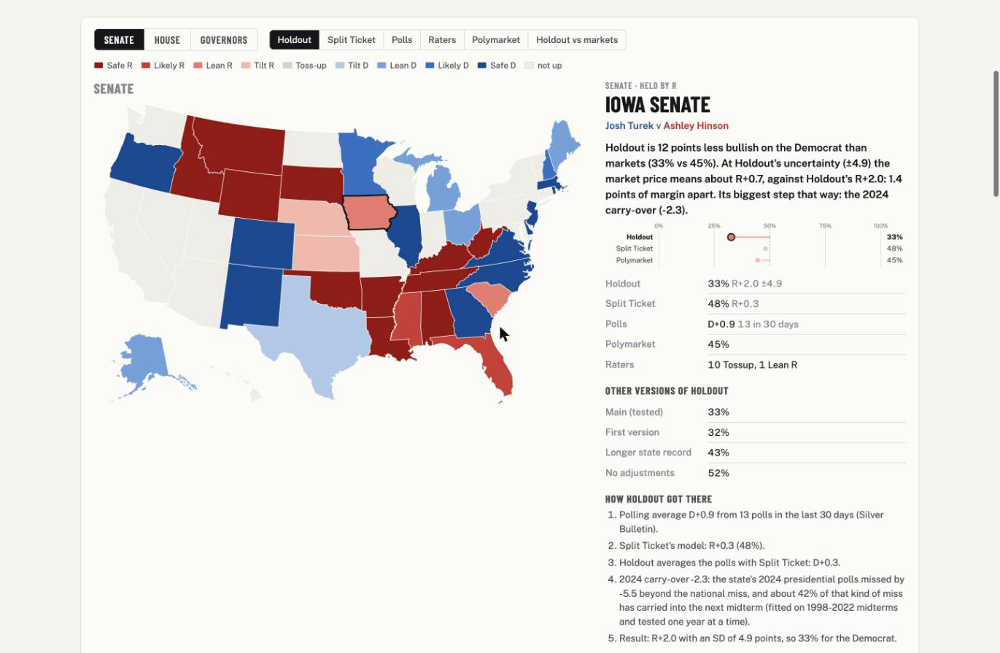
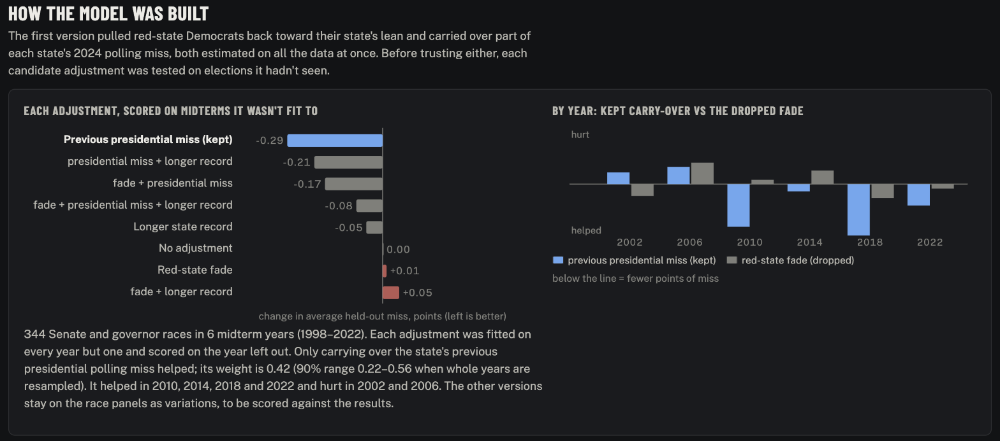
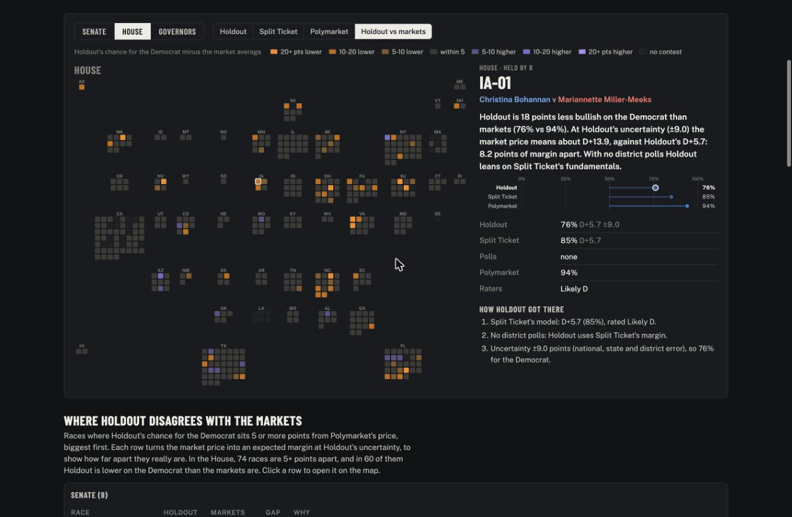
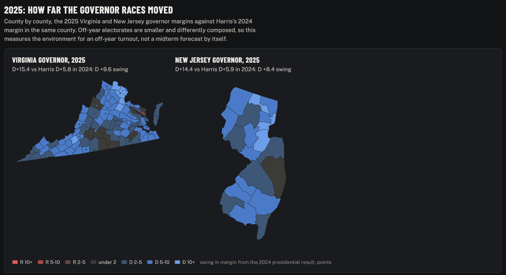
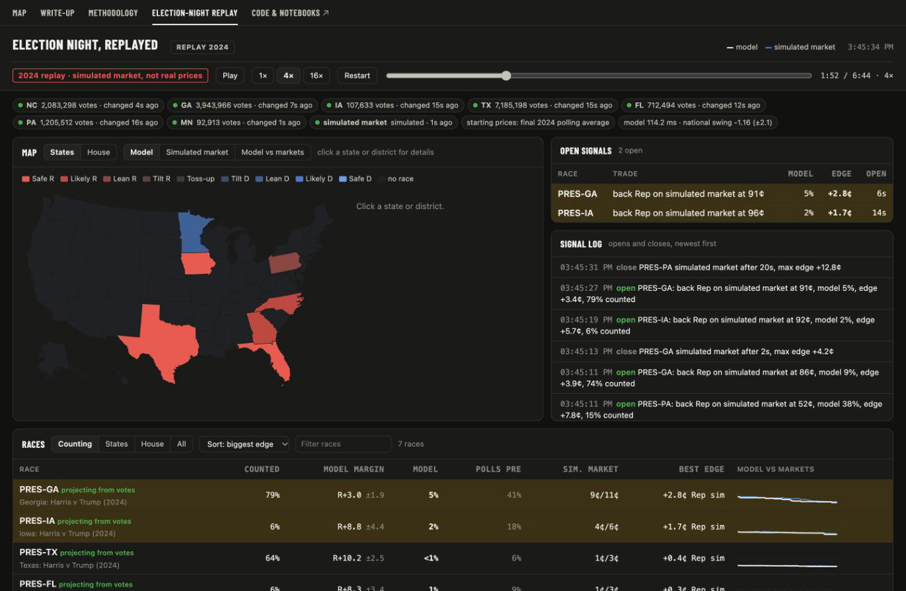

# midterms-2026

**How well did prediction markets, forecast models and polls call the 2026 US midterms (Tuesday, November 3), race by race?** This repo records all three twice a day until the results are in, builds Holdout, my midterm polling-error model, whose adjustments had to predict past elections they weren't fitted to, and runs an election-night dashboard that projects races from county returns and sets them against Kalshi and Polymarket. Once the results are certified, every source gets the same scorecard: the probability it gave the eventual winner, how early each race locked in, and how well calibrated it was across hundreds of races.

<picture>
  <source media="(prefers-color-scheme: dark)" srcset="docs/img/map-senate-iowa-dark.png">
  
</picture>

**See it:** [live map](https://axel5o5.github.io/midterms-2026/) · [write-up](https://axel5o5.github.io/midterms-2026/writeup.html) · [methodology](https://axel5o5.github.io/midterms-2026/methodology.html) · [election-night replay](https://axel5o5.github.io/midterms-2026/replay.html) · [how Holdout was chosen (notebook 04)](notebooks/04_model_selection.ipynb)

## What Holdout says before Tuesday (2026-11-02)

**Holdout gives Democrats an 80% chance of the Senate and 95% of the House, close to the markets on both chambers (Polymarket: Senate 76%, House 95%). It parts from the markets most in two Senate races. In Iowa it is 11 points lower (40% for the Democrat; Polymarket 52%), and the gap comes from the one adjustment that survived an out-of-sample test: part of the state's 2024 presidential polling miss carries into 2026. In South Carolina it is 13 points higher (45%; 32%), because the polls and Split Ticket have the race closer than the market does. Kansas (59%; 62%) and Texas (72%; 74%) are within 3 points. Iowa's 11 points come to about 1.3 points of margin: the race is close enough that a small shift moves the odds a lot.**

To see it: the [live map](https://axel5o5.github.io/midterms-2026/) has every race with each source's number, as of the 2026-11-02 9pm ET snapshot and Polymarket's prices then; [notebook 04](notebooks/04_model_selection.ipynb) shows the test; [Kansas, Iowa, Texas](docs/special-cases-ks-ia-tx.md) works through the three carry-over races as of 2026-10-30, when Kansas stood at 39% (Split Ticket's 11-02 update moved it).

---

- **Holdout keeps only what predicted out of sample** ([notebook 04](notebooks/04_model_selection.ipynb), `midterms.carryover`). Three state-level adjustments were each fitted on all midterm years but one and scored on the year left out, over 344 Senate and governor races (2002-2022).
  - Carrying over a share of the state's previous presidential polling miss cut the average held-out miss from 5.56 to 5.27 points. It helped in 2010, 2014, 2018 and 2022 and hurt in 2002 and 2006. Weight 0.42, 90% range 0.22-0.56.
  - Since 2026-11-02 the weight is split by the direction of the 2024 miss: 0.54 when polls underrated Democrats (90% range 0.37-0.63) and 0.26 when they underrated Republicans (-0.02 to 0.48). Held-out miss 5.24. The split's held-out predictions come out about half a point too Democratic in both directions, against a tenth of a point for the single weight, which stays on the map as a variant.
  - The "red-state fade" (pulling candidates who poll far above their state's lean back toward it) scored 5.57, no better than the polls as they are. A longer state polling record helped a little on its own (5.51) but made things worse on top of the carry-over (5.35). Discounting misses built from few polls didn't help either.
  - The versions that didn't pass stay on the map page as labelled variations of Holdout, to be scored after the results: its first version (fade plus a 0.34 carry-over, 74% Senate), the single 0.42 weight (78%), the longer-record version (82%) and no adjustments (82%).

  

- **Polling error** ([brief](docs/polling-error-research.md), measured on 538's raw polls 1998-2022): a national miss shared by every race (SD 3.0, fat-tailed: t with 5 df), a state miss (SD 2.7) and a race miss (SD 2.7, wider where polling is thin). That totals about 4.9 points of margin for a well-polled Senate race, matching the 4.9 measured. The national miss has no predictable direction from one cycle to the next, so Holdout centers it at zero.
- **Kansas, Iowa, Texas** ([write-up](docs/special-cases-ks-ia-tx.md)). Independent research briefs land between Holdout and the markets: 40-45%, 38-44% and 62-66%. All three have a weak Republican Senate nominee on an otherwise healthy Republican ticket. Kansas's 2024 carry-over rests on a single poll, and Iowa's includes Selzer's final-week outlier.
- **House** ([notebook 02](notebooks/02_house.ipynb)): Democrats win the majority in 96% of 100,000 simulations, median 239 seats, 80% range 224-257 (snapshot of 2026-10-29). The districts where Holdout and the markets disagree most are listed there.

  

- **Other forecasters** ([notes](docs/forecasters-and-track-record.md)): published Senate odds run from the Economist's 53% to Silver Bulletin's 76%, and [notebook 01](notebooks/01_polling_error_and_senate.ipynb) shows they all fit within about 2 points of assumed national polling bias. In 2018 and 2022, the forecast that blended polls, fundamentals and expert ratings (538's "Deluxe") scored best across all races, and beat the markets on the races they traded (Brier 0.088 against PredictIt's 0.096 in 2018; 0.112 against Polymarket's 0.130 in 2022, on only 32 thinly traded races).
- **Outside signals.** The 2025 Virginia and New Jersey governor races swung 9.6 and 8.5 points toward Democrats from 2024 (certified county results, `midterms.results2025`). Special elections since January 2025 have run 12.5 points ahead of Harris on average; the brief treats that as evidence about the environment the polls already show, not about which way they'll miss. [Early vote against the same point in 2022](docs/early-vote-2022-vs-2026.md) is mixed.

  

## What's inside

| | |
|---|---|
| [Methodology](docs/methodology.md) | The paper: how Holdout is built and tested, in full. |
| [01 · Polling error and the Senate](notebooks/01_polling_error_and_senate.ipynb) | How big polling misses have been since 1998, how they're shared, and what that does to Senate control. Holdout's first version. |
| [02 · The House](notebooks/02_house.ipynb) | All 435 districts under the same error model; where Holdout and the district markets disagree. |
| [03 · Election night](notebooks/03_election_night.ipynb) | Projecting a race from partial county returns, tested by replaying 2024's count in seven states. |
| [04 · Model selection](notebooks/04_model_selection.ipynb) | Which adjustments survive a test on elections they weren't fitted to. Holdout as it stands. |
| [Polling error research](docs/polling-error-research.md) | The literature and my own decomposition behind the error model. |
| [Kansas, Iowa, Texas](docs/special-cases-ks-ia-tx.md) | Why Holdout sits below the markets in three races. |
| [Other forecasters](docs/forecasters-and-track-record.md) | The 2026 models compared, and how models and markets did in 2018 and 2022. |
| [Early vote, 2022 vs 2026](docs/early-vote-2022-vs-2026.md) | Party split of ballots cast so far, against the same point in 2022. |

All the write-ups are indexed in [docs/](docs/README.md). The code is in `src/midterms/`: `snapshot` (collection), `senate`, `house` and `carryover` (Holdout), `pres2024` and `results2025` (inputs), `live/` (election night) and `web/` (the map page).

## Election night

**On Tuesday night a dashboard on your own machine projects each race from county returns as they post, and flags where the projection and the markets disagree after fees. It reads prices and never places trades.** The [replay](https://axel5o5.github.io/midterms-2026/replay.html) runs it on 2024's presidential count (the market in the replay is simulated).



`uv run python scripts/live.py` opens it at http://127.0.0.1:8765; `--replay-2024` runs the replay locally.

- **What it shows:** every Senate and House race, its live odds against the prediction markets, both chambers, a map, open signals and a signal log. It updates within a second of a price move or a new vote file.
- **Prices:** Polymarket streams over its public websocket. Kalshi streams over its websocket with an API key kept outside the repo (`~/.kalshi/config.json`), or is checked every 5 seconds without one.
- **Starting point:** each race starts from the market price at the moment its first votes land (`--prior model` starts from Holdout's forecast instead). So a signal means the votes moved the dashboard's odds at least 3 cents away from the market after fees. Prices outside 3-97 cents never fire.
- **Projection** ([notebook 03](notebooks/03_election_night.ipynb)): county by county against the 2024 presidential baseline, adjusted for vote type (mail, early, Election Day). On 2024 replays its 90% intervals covered the final margin about 97% of the time, but those settings were tuned on the same replays, so expect less on the night.
- **Logs:** `data/live/<date>/` (model.csv, quotes.csv, events.csv), to score the signals afterwards.

Results feeds, each checked against its 2024 results. Files are checked every 15-60 seconds and downloaded only when they change.

| State | Source | Coverage |
|---|---|---|
| NC, FL, MN | state results files | all counties; 2026 files already live |
| GA | state API | all counties, once its 2026 file posts |
| IA, SC | state results sites (Clarity) | all counties; 2026 files already live |
| TX | Harris (its own results files) plus Dallas, Tarrant, Denton, Fort Bend, Williamson and El Paso (Clarity), with 2024 vote-type leans; Travis once it posts (the state's new results site blocks AI crawlers) | 40% of the 2024 vote |
| OH | state XML | untested on real counts; rate-limits hard |
| KS | **bookmark**: open the state results page in your browser and click "Send to dashboard" (the state site is behind a Cloudflare check, so the tool never fetches it); backup: Johnson, Sedgwick and Douglas counties | 105 counties; backup 46% of the 2024 vote |
| MI | Oakland, Macomb, Genesee, Ottawa (Clarity) and Washtenaw, with 2024 vote-type leans | 34% of the 2024 vote |
| NE | Secretary of State results site (turned on 2026-10-30; Osborn takes the non-Republican slot), plus Sarpy County (Clarity) | all 93 counties |

No usable feed: WI, AZ, NH, NJ, NY, ME, AK, PA (state sites behind bot checks, statewide-only files, or no 2026 Senate race). Those races follow their prior plus the national swing.

Before polls close, `uv run python scripts/feeds_2026_check.py` runs the IA, SC and TX feeds once against the live sites and exits 1 if any fails (a wrong id or a file for another election fails loudly). If a state's id changes on the night, put it in `data/live/feed_ids.json` (`{"IA": "<id>"}`) or a Texas county's in `data/live/tx_sources.json`; both are re-read on every check. `uv run pytest` runs the offline tests on saved official files.

## About this public copy

This is the public version of a private research repo, exported with fresh history. It has
all of our code, notebooks, write-ups and derived data. It does not republish the raw
snapshots of Kalshi, Polymarket, Silver Bulletin or Split Ticket data: those belong to their
sources. `python -m midterms.snapshot` collects a fresh one, and notebooks 01, 02 and 04
recompute from it (so their numbers move with the date you run them). The executed notebooks
show the numbers as of the 2026-10-29 and 2026-10-30 snapshots.

Data used here under its own terms: FiveThirtyEight's polling archive
(`data/history/raw_polls_538.csv`), 2020 and 2024 county presidential results compiled by
tonmcg (US_County_Level_Election_Results), the EAC's Election Administration and Voting
Survey, MIT Election Data and Science Lab county returns, us-atlas map shapes, and official
state and county results. Our own code, notebooks and write-ups are MIT-licensed (LICENSE). Every election-night results host was
checked for robots.txt and terms; the ones that block automated access are listed in
`src/midterms/live/feeds.py` and skipped.

## Run

```bash
uv sync
uv run python -m midterms.snapshot              # one snapshot of markets, forecasters and polling averages
uv run python scripts/live.py --replay-2024     # the election-night dashboard on a 2024 replay
uv run python scripts/build_mapbook.py          # the map page -> build/mapbook.html
uv run jupyter lab notebooks/                   # the notebooks (.py files are the source, paired with .ipynb by jupytext)
```

On election night, keep the machine awake: `caffeinate -i uv run python scripts/live.py` on a Mac.

## Data and ethics

- **Only hosts that allow it.** Every source was checked for robots.txt and terms of use before collection, and the election-night results code checks robots.txt again at run time and refuses any host whose robots.txt disallows AI crawlers. Left out for that reason: DDHQ / The Hill and 270toWin (robots.txt; both dropped on 2026-10-29), VoteHub (its terms prohibit automated collection), The Economist (robots.txt) and Race to the WH (robots.txt; its data had also stopped updating). Expert ratings come from Wikipedia's article pages, which its robots.txt allows. Until 2026-10-30 they came from Wikipedia's API, which it disallows; once I noticed I switched, and those API responses aren't in the public copy.
- **No getting around bot checks or logins.** Anything behind one (NYT averages, RCP, Silver Bulletin's paid model, several state results sites) is skipped. Kansas's statewide results site sits behind a Cloudflare check, so the tool never fetches it: a browser bookmark sends the page you already have open to the local dashboard.
- **Light on the hosts.** Each results file is fetched at most every 15 seconds (Georgia every 60, Kansas counties every 45), always as a conditional request, so an unchanged file costs the host a header-only reply.
- **Raw third-party data isn't republished.** The public copy has my code, notebooks, write-ups and derived numbers, not raw market or forecaster snapshots, which belong to their sources. Market figures in the public write-ups are Polymarket's.

## Status, and what happens after November 3

**Collecting until November 6; the scoring comes after the results.** `scripts/snapshot_and_commit.sh` runs at 9:00 and 21:00 and commits each snapshot: every Polymarket midterm market (1,259 events on 2026-10-30), Split Ticket's model, Silver Bulletin's polling averages and the polls behind them, and ratings from Cook, Sabato, Inside Elections and eight others. Market prices stay retrievable after the election; the forecasters' daily numbers mostly don't, which is why this runs now.

After the results, every source gets the same treatment, race by race: the probability it gave the eventual winner over time, how far ahead each race locked in, calibration across hundreds of races, markets against models, and the four versions of Holdout against each other. The election-night log gets scored the same way: did a signal beat the market's later price? A planned extra is a language model given only what was knowable before each race.

## License

My code, notebooks and write-ups are MIT-licensed ([LICENSE](LICENSE)). Third-party data stays under its own terms.
