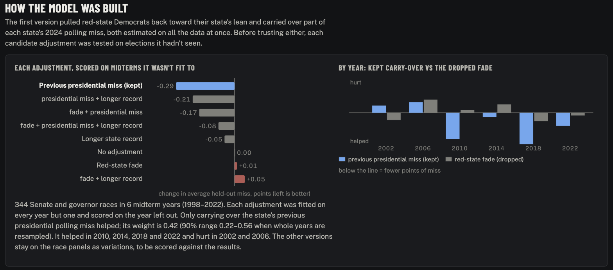
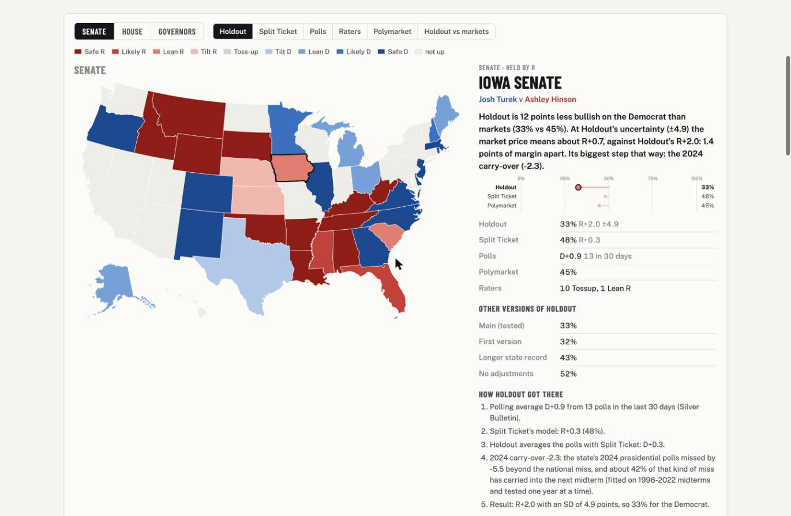
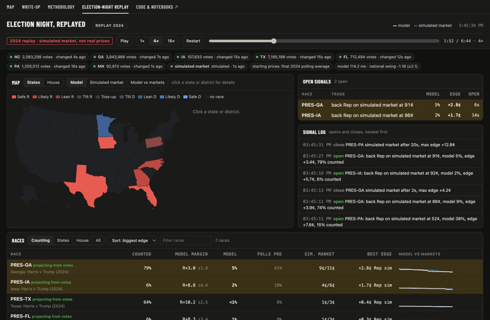
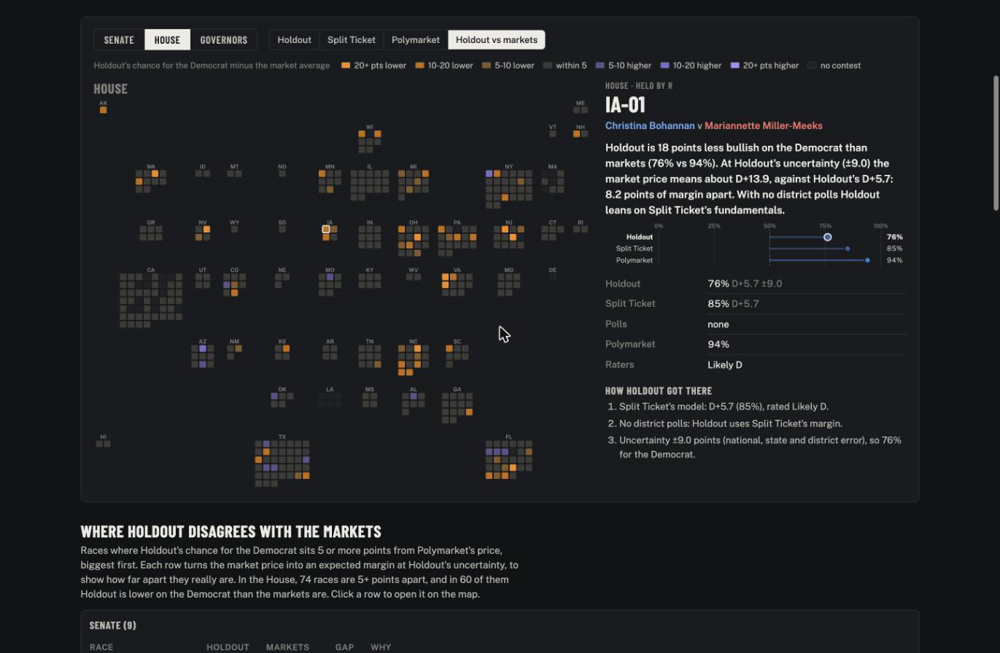

# The 2026 midterms: what I built before Tuesday

*Axel Browne · October 30, 2026*

**Before Tuesday's midterms I built three things: a twice-daily record of what prediction markets, forecast models and polling averages said about every race, a polling-error model of my own (Holdout), and a read-only dashboard for election night. The step that changed the model most was testing each adjustment on elections it hadn't been fit to. The one that looked most intuitive did nothing, and I took it out.**

If you want to look at it:

- [The map](https://axel5o5.github.io/midterms-2026/) has every race and every source side by side, with the reasoning behind each number.
- [The replay](https://axel5o5.github.io/midterms-2026/replay.html) runs the election-night dashboard in your browser on the 2024 count.
- [The repo](https://github.com/axel5o5/midterms-2026) has the code, notebooks and write-ups, MIT-licensed.

After the results I'll score every source race by race, along with the versions of Holdout I dropped.

---

## What I set out to do

I wanted to know how well each kind of forecaster calls an election, race by race: prediction markets against models, and all of them against the polls. Answering that needs a record of what each source said and when, and nobody keeps one for you. So the first thing I built was a collector. Then I built my own forecast, so that one model in the comparison would have every assumption written down where I could test it. Last came a tool for election night that compares counted votes with live prices.

## The data, and why the snapshots matter

At 9:00 and 21:00 every day through November 6, a scheduled job saves every midterm market on Polymarket (1,259 events). Next to them it saves Split Ticket's model, Silver Bulletin's polling averages and the polls behind them, and the ratings from Cook, Sabato, Inside Elections and eight other raters. Each run is committed to the repo with its timestamp.

The timing is the reason it exists. Market prices stay retrievable after an election, since both exchanges keep their price history. A forecaster's daily number mostly doesn't. Once the results are in, the page shows the final forecast or nothing. If I want to know where a model stood on the Friday before the election, I have to save it on that Friday.

I left a lot out on purpose. Before collecting from any site I checked its robots.txt and its terms. Decision Desk HQ and 270toWin both disallow AI crawlers in their robots.txt, and VoteHub's terms prohibit automated collection, so I removed all three on October 29. Anything behind a login or a bot wall stayed out too, including the New York Times averages, RealClearPolling and Silver Bulletin's paid model. The public copy of the repo has my code, notebooks and derived data. It doesn't republish the raw snapshots, which belong to their sources.

## The polling-error model

A forecast built on polls is mostly a claim about how wrong the polls can be. I measured that from 538's archive of raw polls, 1998 to 2022, and split each race's miss into three parts: a national miss shared by every race that year, a miss shared by every race in one state, and whatever is left over for the race itself.

```
margin error = national + state + race
```

The national part has a standard deviation of 3.0 points. I drew it from a Student-t with 5 degrees of freedom, so a large miss stays possible. The state and race parts are 2.7 points each for a well-polled race, and the race part grows where few pollsters are working. Added together that comes to about 4.9 points for a well-polled Senate race, which matches the 4.9 I measured from the archive directly.

The national miss has no usable direction. Its sign has flipped back and forth from one cycle to the next, so I centered it at zero and let it be wide.

## Choosing the model out of sample

My first version had two adjustments on top of that error model, and I'd estimated both on the same history they were meant to explain. One was a "red-state fade": pull a candidate who polls far ahead of their state's presidential lean back toward it. Fitted that way, it came out at -0.08 per point above the lean. It went straight into the first version. The other carried over part of each state's polling miss from the most recent presidential race.

That first version put the Democrats in Kansas, Iowa and Texas 12 to 17 points below the markets. The tempting fix was to keep adjusting until those three races matched, and that would have made my model a copy of the markets. So I tested each candidate adjustment on elections it hadn't seen.

I used 344 Senate and governor races from the six midterms between 2002 and 2022. The target was each race's miss beyond that year's national miss, since the national part has nothing to predict. I fit each adjustment on five midterms, scored it on the sixth, and rotated through all six.



| Adjustment | Held-out average miss (points of margin) |
|---|---|
| Previous presidential miss carried over | 5.27 |
| Carry-over plus the state's longer record | 5.35 |
| Fade plus carry-over | 5.38 |
| The state's longer record alone | 5.51 |
| No adjustment | 5.56 |
| Fade alone | 5.57 |

The fade did nothing. The pattern behind it does show up in the raw numbers. In 69 races since 2000 where the Democrat or an independent polled within 5 points in a state that voted Republican by 10 or more, the Republican beat the polls by 2.4 points on average. About 1.1 of that was the national miss in those years. The rest didn't scale with how far above the lean a candidate polled, at least not in a way that predicted the next set of races. I think candidate quality cuts both ways here. This year's three closest red-state Senate races each have a weak Republican nominee on a ticket whose other Republicans poll fine, and a fade built on the state's lean would have penalized exactly that.

The carry-over was the only adjustment that helped. It improved the held-out score in 2010, 2014, 2018 and 2022. It made it worse in 2002 and 2006. Its weight is 0.42, which means the model carries over 42% of a state's last presidential polling miss. When I resampled whole years, 90% of the fits landed between 0.22 and 0.56.

I tried one more thing, because Kansas's 2024 miss rests on a single survey: discounting any miss built from only a few polls. It made the score slightly worse, 5.29 against 5.27. States with thin polling kept being mispolled in the history, so a thin input still carried signal.

Holdout, named for this test, keeps the carry-over and drops everything else. It's a modest result. Six midterms is a small sample, the gain is about 5% of the error, and it lost in two of the six years. I think it's still the right call, since it's the one adjustment I can show predicted elections it wasn't fit to.

For context on what that did to the forecast: Holdout ended up close to the markets on Senate control, 73% for Democrats against 73% on Polymarket. It still sits below them in Kansas, Iowa and Texas, by 1.3 to 1.7 points of expected margin in each, and those are the states where the 2024 polls overstated Harris most. I had three research briefs written, one per state, and all three landed between my numbers and the markets'. The first version, the longer-record version and the no-adjustment version all stay on the map page, so Tuesday scores them too.



## The election-night tool

On Tuesday night a dashboard on my own machine streams prediction-market prices and reads official county results. I built results feeds for 11 states. Each one checks its state's file every 15 to 60 seconds and downloads it only when it has changed. The tool projects each race county by county against the 2024 presidential result, adjusted for how mail, early and Election Day votes leaned in 2022.

Each race starts from the market price at the moment its first votes land, so a signal means the counted votes have moved my odds at least 3 cents away from the market after fees. Prices outside 3 to 97 cents never fire. It's read-only and places no orders. Markets usually move within a couple of minutes of new returns, so I expect most of the gaps it flags to be errors in my projection.

I tested it on the 2024 presidential count in seven states, replaying each one in eight simulated reporting orders. Its 90% intervals covered the final margin in about 97% of snapshots between 10% and 95% counted. I tuned the uncertainty settings on those same replays, so I expect lower coverage on real counts. Florida and Texas were the hard cases. The counties that finished first there looked least like the ones that finished last, and the projection sat 3 to 4 points too Democratic for most of the night.



The constraints decided which states it covers. Several states put their results behind bot checks, and I didn't try to get around any of them. Kansas is the clearest case. Its results site sits behind a Cloudflare check, so the tool never fetches it. A bookmark in my own browser sends the page I have open to the dashboard instead, and three county sites (Johnson, Sedgwick and Douglas, about 46% of the state's vote) back it up. Eight states, including Wisconsin, Arizona and Pennsylvania, have no usable feed at all, so those races move only with their prior and the national swing. Iowa and South Carolina posted their 2026 election ids in the last few days before the election. Texas moved its results to a new site that blocks AI crawlers, so Texas comes from seven of its counties' own sites, about 40% of its vote.

## What I'll score after Tuesday

Once the counts are final, I'll go through every source race by race:

- the probability each source gave the eventual winner, over the days before the election, and how far ahead of the result each race locked in
- calibration across hundreds of House, Senate and governor races
- the markets against the forecast models
- Holdout against the three versions I dropped, which is the real test of choosing out of sample
- the dashboard's coverage on real counts against the 97% from the replays, and how quickly the gaps it flagged closed



I'll add that write-up here when it's done.
